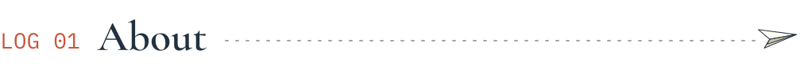
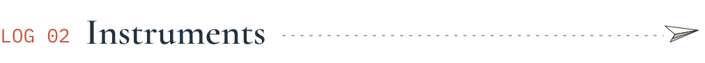
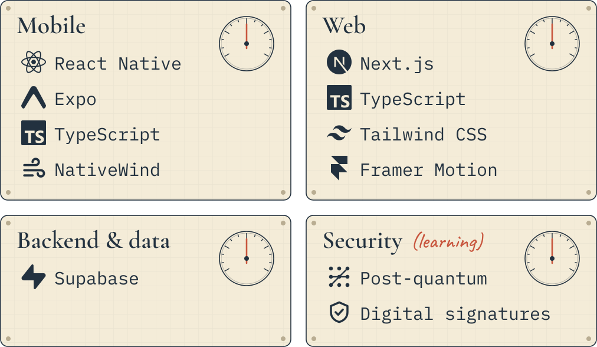
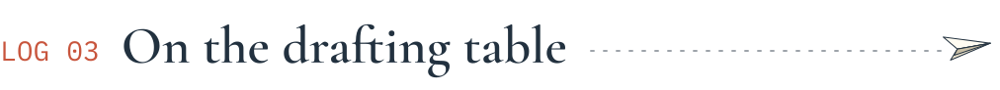
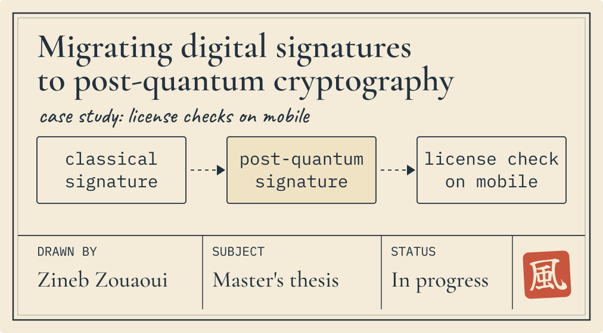
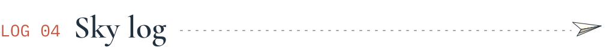
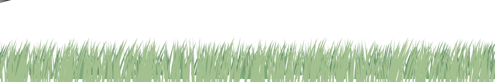

<!-- Hero -->

  <picture>
    <source media="(prefers-color-scheme: dark)" srcset="assets/hero-night.svg">
    <source media="(prefers-color-scheme: light)" srcset="assets/hero-day.svg">
    
  </picture>

<!-- Quote -->

  <picture>
    <source media="(prefers-color-scheme: dark)" srcset="assets/quote-night.svg">
    <source media="(prefers-color-scheme: light)" srcset="assets/quote-day.svg">
    
  </picture>

<!-- Contact -->

  
  

<!-- About -->
<picture>
  <source media="(prefers-color-scheme: dark)" srcset="assets/heading-about-night.svg">
  <source media="(prefers-color-scheme: light)" srcset="assets/heading-about-day.svg">
  
</picture>

**The wind is rising: I build what flies, and I'm learning to keep it safe.**

I'm Zineb, a final-year Master's student in Information Systems Engineering at Université de Sidi Bel Abbès, Algeria, and a freelance mobile and web developer with real client projects behind me.

I build calm, useful software (healthcare apps, public-service tools, knowledge platforms), and I'm now learning to protect it with post-quantum cryptography.

I've always wanted to help people. Technology is how I do it.

I think and write in Arabic first, and I work in English (B2) and French (B1).

<!-- Stack -->
<picture>
  <source media="(prefers-color-scheme: dark)" srcset="assets/heading-stack-night.svg">
  <source media="(prefers-color-scheme: light)" srcset="assets/heading-stack-day.svg">
  
</picture>

  <picture>
    <source media="(prefers-color-scheme: dark)" srcset="assets/stack-night.svg">
    <source media="(prefers-color-scheme: light)" srcset="assets/stack-day.svg">
    
  </picture>

<!-- Selected work: add project cards here later -->

<!-- On the drafting table -->
<picture>
  <source media="(prefers-color-scheme: dark)" srcset="assets/heading-table-night.svg">
  <source media="(prefers-color-scheme: light)" srcset="assets/heading-table-day.svg">
  
</picture>

  

<!-- Contribution sky: redrawn daily by .github/workflows/sky.yml -->
<picture>
  <source media="(prefers-color-scheme: dark)" srcset="assets/heading-sky-night.svg">
  <source media="(prefers-color-scheme: light)" srcset="assets/heading-sky-day.svg">
  
</picture>

  <picture>
    <source media="(prefers-color-scheme: dark)" srcset="https://raw.githubusercontent.com/z-Pearlina/z-Pearlina/output/sky-night.svg">
    <source media="(prefers-color-scheme: light)" srcset="https://raw.githubusercontent.com/z-Pearlina/z-Pearlina/output/sky-day.svg">
    
  </picture>

<!-- Footer -->

  <picture>
    <source media="(prefers-color-scheme: dark)" srcset="assets/footer-night.svg">
    <source media="(prefers-color-scheme: light)" srcset="assets/footer-day.svg">
    
  </picture>

  Inspired by Hayao Miyazaki's <i>The Wind Rises</i> (2013). All illustration here is original. 
  "Le vent se lève, il faut tenter de vivre." Paul Valéry, <i>Le Cimetière marin</i> (1920).

